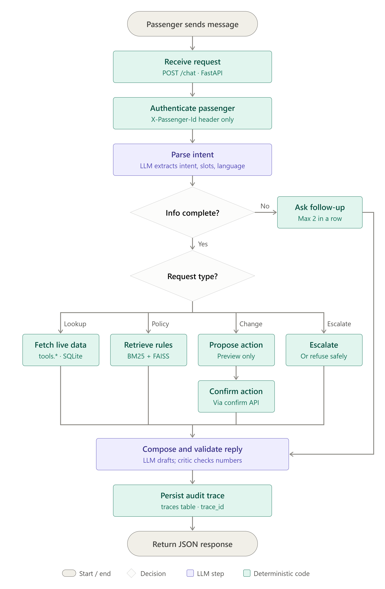

# Ujjwal Rail Assistant

An AI travel assistant for **Ujjwal Rail**, a fictional train operator. It helps passengers find trains, check seats and fares, understand the rules, work out refunds, and book, cancel or change tickets after they confirm.

Built for the HCLTech *Future Ready AI Engineer* Hackathon.

> **Design principle:** the LLM understands the question and writes the reply. Plain Python code does everything exact: searching trains, checking seats, fares, refunds, deadlines and changing bookings.

---

## Features

- **Train search, seats and fares** come from SQLite through deterministic tools. The assistant never invents them.
- **Rule answers cite their source** (document ID and section). Retrieval combines BM25 keyword search with FAISS embeddings.
- **Newer rules win.** A circular overrides the older rule from its effective date, and an official rule overrides an FAQ. Any clash is logged.
- **Refunds are calculated by code** from the `settings` table and tested at every cut-off.
- **Safe changes:** propose → passenger confirms → code executes → code re-checks. Confirming is idempotent.
- **Hand-over to a person** for complaints, disputes, safety issues and low-confidence answers. The assistant never promises an outcome.
- **Privacy:** the passenger is identified only by the `X-Passenger-Id` header. Bookings that belong to someone else get a refusal that doesn't reveal whether they exist, and phone and ID numbers are masked.
- **Prompt-injection resistant:** retrieved content and user messages are treated as data, never as instructions.
- **English, Hindi and Hinglish:** replies use the passenger's language.
- **Live ingest:** `POST /ingest` makes new rules usable immediately, without a restart.
- **Audit trace** for every reply, which you can replay with `GET /trace/{trace_id}`.

## Architecture



| Step | Component | Type |
|---|---|---|
| 1 | Receive `POST /chat` (FastAPI) | Code |
| 2 | Authenticate from the `X-Passenger-Id` header | Code |
| 3 | Parse intent, slots and language | **LLM** |
| 4 | If slots are missing, ask a follow-up (max 2 in a row) | Code |
| 5 | Route by request type: **Lookup** (`tools.*` on SQLite) · **Policy** (BM25 + FAISS) · **Change** (preview → confirm API) · **Escalate** (hand over or refuse) | Code |
| 6 | Draft the reply, then a critic checks every number against tool output | **LLM** + Code |
| 7 | Save the audit trace to the `traces` table and return JSON | Code |

The pipeline is a single agent with a router. There is no multi-agent setup, because nothing in the brief needs one.

## Tech Stack

| Layer | Choice |
|---|---|
| API | FastAPI (Python 3.11+) |
| UI | Streamlit chat with Confirm and Cancel buttons |
| LLM | Ollama (local), with `MOCK_LLM=true` for offline testing |
| Retrieval | `rank_bm25` + FAISS (sentence-transformers embeddings) |
| Storage | SQLite: trains, bookings, settings, actions and traces |
| Packaging | Docker Compose |

## Project Structure

```
.
├── app/
│   ├── main.py            # FastAPI app and endpoints
│   ├── pipeline.py        # intent → route → compose → critic → trace
│   ├── llm.py             # Ollama client and mock LLM
│   ├── retrieval.py       # BM25 + FAISS hybrid search, precedence rules
│   ├── tools/             # search_trains, seat_availability, fare, refund_quote, booking_status
│   ├── actions.py         # propose / confirm / cancel / verify
│   ├── escalation.py      # hand-over summaries per desk
│   ├── privacy.py         # ownership checks, PII masking
│   └── db.py              # SQLite access
├── ui/streamlit_app.py
├── data/
│   ├── docs/              # rules (RUL-*), circulars (CIR-*), FAQs (FAQ-*)
│   ├── prompts/           # exact LLM prompts used to generate data
│   ├── generate_data.py
│   ├── validate_data.py
│   └── DATA_NOTE.md
├── eval/
│   ├── eval_set.jsonl     # 30+ cases with expected answers or actions
│   ├── run_eval.py
│   └── RESULTS.md
├── samples/traces/        # 3 sample audit records
├── tests/                 # unit tests (refund cut-offs, midnight trains, idempotency)
├── docker-compose.yml
└── .env.example
```

## Quick Start

```bash
cp .env.example .env
docker compose up --build
```

- API: http://localhost:8000 (docs at `/docs`)
- UI: http://localhost:8501

**Local, without Docker:**

```bash
pip install -r requirements.txt
python data/generate_data.py && python data/validate_data.py
MOCK_LLM=true uvicorn app.main:app --reload
streamlit run ui/streamlit_app.py
```

### Configuration

| Variable | Default | Description |
|---|---|---|
| `MOCK_LLM` | `false` | Use deterministic mock responses instead of calling the LLM |
| `OLLAMA_URL` | `http://ollama:11434` | Ollama endpoint |
| `LLM_MODEL` | `llama3.1:8b` | Model name |
| `DB_PATH` | `data/ujjwal.db` | SQLite file |

## API

| Method | Endpoint | Purpose |
|---|---|---|
| `POST` | `/chat` | Send a message. Header: `X-Passenger-Id`. Body: `session_id`, `message`, optional `as_of` |
| `POST` | `/actions/{id}/confirm` | Confirm a proposed change. Only the owner can confirm, and confirming twice has no extra effect |
| `POST` | `/actions/{id}/cancel` | Drop a proposed change |
| `GET` | `/bookings/{id}` | Fetch one booking (owner only) |
| `POST` | `/ingest` | Add or update a rule, circular or FAQ (takes effect immediately) |
| `GET` | `/trace/{trace_id}` | Replay how an answer was produced |
| `GET` | `/health` | Readiness check |

```bash
curl -X POST localhost:8000/chat \
  -H "X-Passenger-Id: P001" -H "Content-Type: application/json" \
  -d '{"session_id":"s1","message":"Trains from Pune to Nagpur on 5 Dec after 6 pm?"}'
```

**Answer types:** `answer` · `clarification` · `confirm_needed` · `action_done` · `handed_to_human` · `not_found` · `refusal`

### Change permission levels

| Level | Scope | Behaviour |
|---|---|---|
| 0 | Lookups (search, fares, status, refund quote) | Answer immediately |
| 1 | Book, cancel or change the passenger's own booking within the rules | Preview → confirm → execute → verify |
| 2 | Refund disputes, concessions that need proof | Hand over to a person; never promise approval |
| 3 | Refund more than the rule allows, jump the waitlist, change a fare, act on someone else's booking | Refuse |

## Data

All data is invented and generated with an LLM, then reviewed by hand. See [data/DATA_NOTE.md](data/DATA_NOTE.md).

- **Documents:** at least 12 rules, 6 circulars (2 or more override an older rule, 1 or more take effect in the future) and 20 FAQs (2 or more out of date), some written in Hindi or Hinglish.
- **Records:** 15 stations, 25 trains, 14 days of seat availability, 25 passengers and 50 bookings covering every status.
- **Edge cases:** a cancellation exactly at a refund cut-off and one minute after it, trains that leave after midnight, a booking with some travellers confirmed and others waitlisted, a passenger with no bookings, and stations with similar names.
- **Schema:** uses the required table and column names (`stations`, `trains`, `train_stops`, `fares`, `seats`, `passengers`, `bookings`, `booking_travellers`, `actions`, `settings`).

## Evaluation

```bash
python eval/run_eval.py   # writes eval/RESULTS.md
```

The eval set has 30+ cases covering tools, refund cut-offs, circular overrides, changes, hand-overs, vague questions, Hinglish, privacy and prompt injection.

| Metric | Result |
|---|---|
| Correctness | _TBD_ |
| Groundedness | _TBD_ |
| Number accuracy | _TBD_ |
| Unsafe changes (target 0) | _TBD_ |
| Hand-over precision / recall | _TBD_ |
| Privacy or injection failures (target 0) | _TBD_ |
| Latency p50 / p95 | _TBD_ |

## Testing

```bash
pytest tests/
```

## Team & AI Usage

| Member | Contribution |
|---|---|
| _TBD_ | _TBD_ |

**AI-assisted parts:** _TBD (list the files or parts written with AI coding tools)._

## License

Hackathon submission. All data is fictional.
